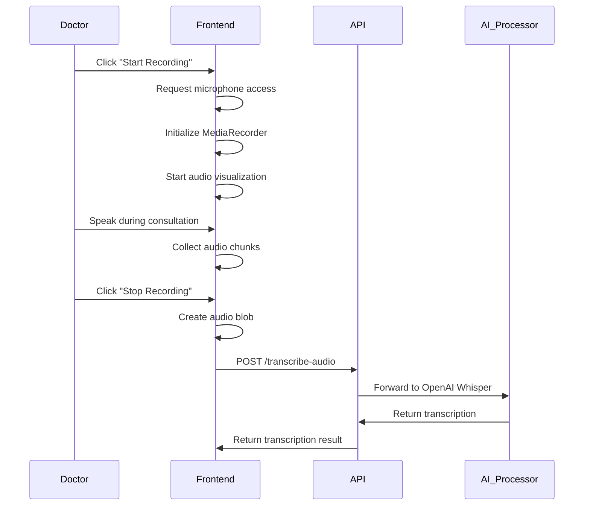
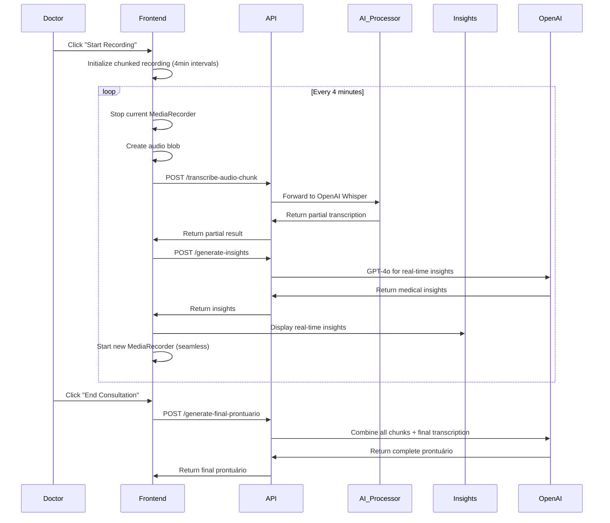
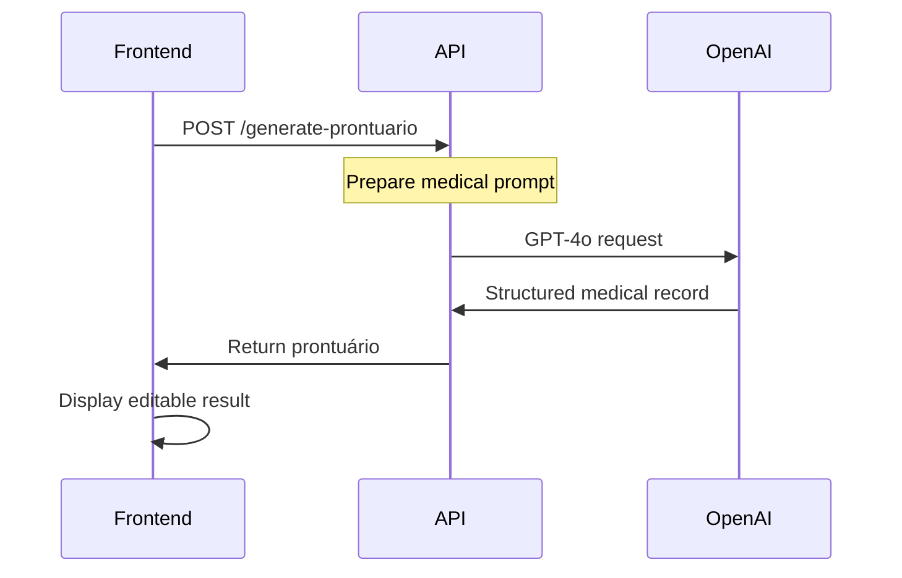
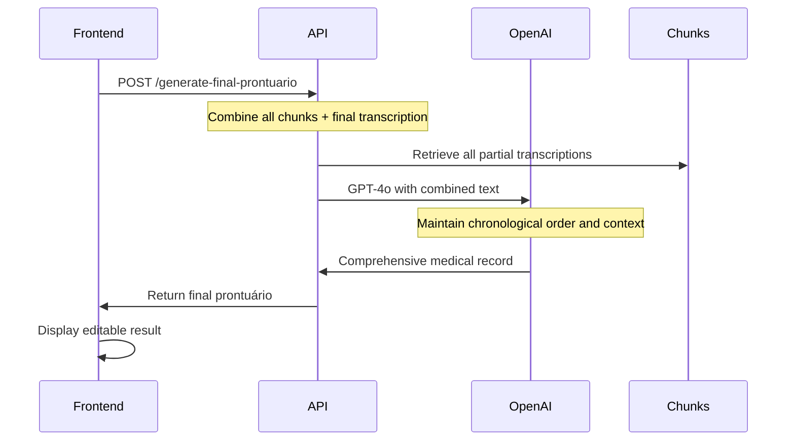

# ProntoDoc System Architecture

## Overview

ProntoDoc is a medical consultation recording and transcription system that allows doctors to record patient consultations and automatically generate medical records (prontuários) and structured medical records in supabase database using AI. The system combines real-time audio recording, AI-powered transcription, and intelligent medical document generation.

## System Components

### 1. Frontend Components

#### Page Structure
```
/doctor/prontodoc/page.tsx
├── DashboardLayout (layout wrapper)
└── ProntoDocPage (main component)
    ├── PatientSearchAndDisplay (hidden in test mode)
    ├── ConsultationTemplateSelector
    └── RecordingAndTranscription (core functionality)
```

#### Key Components

**ProntoDocPage.tsx**
- Main orchestrator component
- Manages patient selection, template selection, and prontuário state
- Currently operates in test mode with a default patient
- Handles state management between child components

**RecordingAndTranscription.tsx**
- Core recording and AI processing component
- Handles real-time audio recording using MediaRecorder API
- Manages audio visualization during recording
- Coordinates transcription and prontuário generation
- Provides editing interface for generated medical records
- **NEW: Supports chunked recording for long consultations (4min intervals)**
- **NEW: Real-time insights display during long consultations**

**ConsultationTemplateSelector**
- Allows doctors to select or create consultation templates
- Templates define AI prompts and structure for different medical specialties
- Supports custom templates and default SOAP format

### 2. API Routes

#### Doctor API Endpoints

```
/api/doctor/
├── transcribe-audio/          # Audio transcription api endpoint proxy/forwarder to the python processing deployed on railway using OpenAI Whisper
├── transcribe-audio-chunk/    # NEW: Chunked transcription for long consultations (4min intervals)
├── generate-insights/         # NEW: Real-time medical insights from partial transcriptions
├── generate-final-prontuario/ # NEW: Final prontuário combining all chunks
├── generate-prontuario/       # AI-powered medical record generation (legacy)
├── save-prontuario/          # Save generated records to database
├── consultation-templates/    # Template management
├── patient-search/           # Patient lookup
├── patient-search-by-name/   # Patient search by name
└── create-patient/           # Create new patient records
```

#### Key API Routes

**POST /api/doctor/transcribe-audio**
- Receives audio files from frontend
- Forwards to AI processor using OpenAI Whisper
- Returns transcription with confidence scores
- Supports multiple audio formats (WebM, MP3, etc.)

**POST /api/doctor/transcribe-audio-chunk** (NEW)
- Handles 4-minute audio chunks for long consultations
- Seamless recording continuation after each chunk
- Returns partial transcription for real-time processing
- Maintains session continuity across chunks

**POST /api/doctor/generate-insights** (NEW)
- Processes partial transcriptions in real-time
- Generates medical insights and hypotheses
- Provides diagnostic suggestions to doctor
- Updates continuously as consultation progresses

**POST /api/doctor/generate-final-prontuario** (NEW)
- Combines all partial transcriptions + final chunk
- Generates comprehensive medical record
- Maintains chronological order and context
- Handles consultation continuity and references

**POST /api/doctor/generate-prontuario**
- Takes transcription text as input
- Uses GPT-4o to generate structured medical records
- Supports custom templates and default SOAP format
- Handles long transcriptions with chunking strategy

**POST /api/doctor/save-prontuario**
- Saves generated medical records to database
- Requires doctor authentication
- Stores records in `medical_records` table

## Workflow

### 1. Recording Phase

#### Standard Recording (Short Consultations)


#### Long Consultation Recording (4-minute chunks)


### 2. Transcription Phase

**Standard Audio Processing:**
- Audio captured in WebM format using MediaRecorder API
- Chunks collected every 1000ms during recording
- Final blob created when recording stops
- Audio sent to AI processor via `/api/doctor/transcribe-audio`

**Long Consultation Processing (NEW):**
- **Chunked Recording:** Automatic 4-minute intervals
- **Seamless Continuation:** New MediaRecorder starts immediately after chunk
- **Real-time Processing:** Each chunk processed independently
- **Session Management:** Maintains consultation context across chunks
- **Insights Generation:** Real-time medical insights from partial transcriptions

**AI Transcription:**
- Uses OpenAI Whisper Large v3 model
- Optimized for Portuguese medical terminology
- Returns confidence scores and word counts
- Handles various audio qualities and lengths
- **NEW: Supports chunked processing for long consultations**

### 3. Prontuário Generation Phase

#### Standard Generation (Short Consultations)


#### Long Consultation Generation (NEW)


**AI Processing:**
- Uses GPT-4o model for medical analysis
- Applies specialized medical prompts based on templates
- Generates structured SOAP format or custom templates
- Handles long transcriptions with intelligent chunking
- **NEW: Combines multiple chunks while maintaining consultation continuity**
- **NEW: Preserves chronological order and cross-references between chunks**

### 4. Template System

**Default SOAP Format:**
```
🧾 Prontuário:
- Alergias: [List allergies or "Não referidas"]
- MUC: [Medications in use or "Não referidas"]
- Comorbidades: [Previous conditions or "Não referidas"]
- S (Subjetivo): [Patient's reported symptoms]
- O (Objetivo): [Physical examination findings]
- A (Avaliação): [Medical assessment/diagnosis]
- P (Plano): [Treatment plan and recommendations]
```

**Custom Templates:**
- Doctors can create specialty-specific templates
- Define custom AI prompts and structure
- Support for different medical specialties
- Public/private template sharing

## Technical Architecture

### Frontend Technologies
- **Framework:** Next.js 14 with App Router
- **UI:** Tailwind CSS with custom components
- **Audio:** MediaRecorder API for real-time recording
- **State Management:** React hooks and context
- **Error Handling:** Error boundaries and comprehensive logging

### Backend Technologies
- **API:** Next.js API routes
- **Database:** Supabase (PostgreSQL)
- **AI Processing:** OpenAI GPT-4o and Whisper
- **Authentication:** Supabase Auth
- **File Storage:** Supabase Storage (for audio files)

### AI Integration
- **Transcription:** OpenAI Whisper Large v3
- **Medical Analysis:** OpenAI GPT-4o
- **Prompt Engineering:** Specialized medical prompts
- **Error Handling:** Timeout management and retry logic

## Data Flow

### 1. Audio Recording
```
Microphone → MediaRecorder → Audio Chunks → Audio Blob → FormData → API
```

### 2. Transcription
```
Audio Blob → AI Processor → OpenAI Whisper → Transcription Text → Frontend
```

### 2b. Long Consultation Transcription (NEW)
```
Audio Chunk (4min) → AI Processor → OpenAI Whisper → Partial Transcription → Real-time Insights → Next Chunk
```

### 3. Medical Record Generation
```
Transcription → GPT-4o → Structured Prontuário → Editable Interface → Database
```

### 3b. Long Consultation Generation (NEW)
```
All Chunks + Final → GPT-4o → Comprehensive Prontuário → Editable Interface → Database
```

## Error Handling

### Frontend Error Handling
- **Error Boundaries:** Catch component errors gracefully
- **User Feedback:** Clear error messages and recovery options
- **Logging:** Comprehensive console logging for debugging
- **Timeout Management:** Handle long-running operations

### Backend Error Handling
- **API Validation:** Input validation and sanitization
- **Authentication:** Proper auth checks for all endpoints
- **Rate Limiting:** Prevent abuse of AI services
- **Fallback Mechanisms:** Graceful degradation when services fail

## Security Considerations

### Authentication
- All doctor endpoints require authentication
- Role-based access control (doctor vs patient)
- Session management via Supabase Auth

### Data Privacy
- Audio files processed securely
- Medical data encrypted in transit and at rest
- HIPAA-compliant data handling practices
- Audit trails for all medical record operations

### API Security
- Input validation and sanitization
- CORS configuration
- Rate limiting on AI endpoints
- Secure environment variable management

## Performance Optimizations

### Audio Processing
- Chunked audio collection (1-second intervals)
- Efficient blob creation and transfer
- Progress indicators for long operations
- Background processing for large files
- **NEW: 4-minute chunked recording for long consultations**
- **NEW: Seamless MediaRecorder restart between chunks**
- **NEW: Real-time processing of audio chunks**

### AI Processing
- Intelligent chunking for long transcriptions
- Timeout management (5-10 minutes)
- Caching of template prompts
- Optimized token usage
- **NEW: Real-time insights generation from partial transcriptions**
- **NEW: Chunk combination with context preservation**
- **NEW: Session management across multiple chunks**

### Frontend Performance
- Lazy loading of components
- Efficient state management
- Optimized re-renders
- Progressive enhancement

## Testing Mode

The system currently operates in a testing mode with:
- Default test patient pre-selected
- Patient selection disabled
- Template validation relaxed
- Comprehensive logging enabled
- Error boundaries for debugging

## Long Consultation Solution

### Problem Solved
- **Issue:** Long consultations (1+ hours) exceed AI model context limits
- **Solution:** Chunked recording with real-time insights and final combination
- **Benefits:** Continuous recording, real-time feedback, comprehensive final prontuário

### Implementation Details

#### Frontend Changes
- **ChunkedRecordingManager:** Manages 4-minute recording cycles
- **RealTimeInsightsDisplay:** Shows live medical insights during consultation
- **SessionStateManager:** Maintains consultation context across chunks
- **SeamlessRecording:** Automatic MediaRecorder restart between chunks

#### Backend Changes
- **Chunked Transcription API:** Processes 4-minute audio segments
- **Real-time Insights API:** Generates medical hypotheses from partial transcriptions
- **Final Prontuário API:** Combines all chunks into comprehensive medical record
- **Session Management:** Tracks consultation progress and context

#### User Experience
- **Continuous Recording:** No interruption during long consultations
- **Real-time Feedback:** Medical insights appear as consultation progresses
- **Final Integration:** Complete prontuário with all consultation content
- **Context Preservation:** Maintains chronological order and references

## Future Enhancements

### Planned Features
- Real-time streaming transcription
- Multi-language support
- Advanced template editor
- Integration with EMR systems
- Mobile app support
- Voice command interface

### Scalability Improvements
- Microservices architecture
- Load balancing for AI processing
- Database optimization
- CDN for static assets
- Caching strategies

## Deployment

### Environment Variables
```env
NEXT_PUBLIC_SUPABASE_URL=your_supabase_url
NEXT_PUBLIC_SUPABASE_ANON_KEY=your_supabase_key
OPENAI_API_KEY=your_openai_key
NEXT_PUBLIC_AI_PROCESSOR_URL=your_ai_processor_url
```

### Production Considerations
- SSL/TLS encryption
- Database backups
- Monitoring and alerting
- Performance monitoring
- Security scanning

## Conclusion

The ProntoDoc system provides a comprehensive solution for medical consultation recording and AI-powered medical record generation. Its modular architecture, robust error handling, and focus on medical accuracy make it suitable for clinical use while maintaining security and privacy standards.

