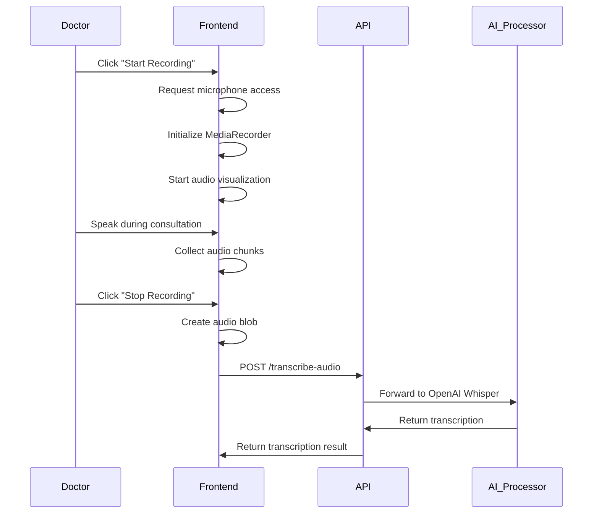
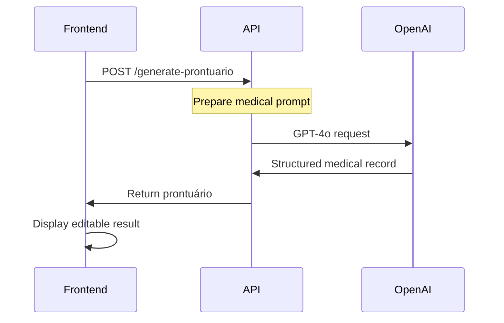

# ProntoDoc System Architecture

## Overview

ProntoDoc is a medical consultation recording and transcription system that allows doctors to record patient consultations and automatically generate medical records (prontuários) and structured medical records in supabase database using AI. The system combines real-time audio recording, AI-powered transcription, and intelligent medical document generation.

## System Components

### 1. Frontend Components

#### Page Structure
```
/doctor/prontodoc/page.tsx
├── DashboardLayout (layout wrapper)
└── ProntoDocPage (main component)
    ├── PatientSearchAndDisplay (hidden in test mode)
    ├── ConsultationTemplateSelector
    └── RecordingAndTranscription (core functionality)
```

#### Key Components

**ProntoDocPage.tsx**
- Main orchestrator component
- Manages patient selection, template selection, and prontuário state
- Currently operates in test mode with a default patient
- Handles state management between child components

**RecordingAndTranscription.tsx**
- Core recording and AI processing component
- Handles real-time audio recording using MediaRecorder API
- Manages audio visualization during recording
- Coordinates transcription and prontuário generation
- Provides editing interface for generated medical records

**ConsultationTemplateSelector**
- Allows doctors to select or create consultation templates
- Templates define AI prompts and structure for different medical specialties
- Supports custom templates and default SOAP format

### 2. API Routes

#### Doctor API Endpoints

```
/api/doctor/
├── transcribe-audio/          # Audio transcription using OpenAI Whisper
├── generate-prontuario/       # AI-powered medical record generation
├── save-prontuario/          # Save generated records to database
├── consultation-templates/    # Template management
├── patient-search/           # Patient lookup
├── patient-search-by-name/   # Patient search by name
└── create-patient/           # Create new patient records
```

#### Key API Routes

**POST /api/doctor/transcribe-audio**
- Receives audio files from frontend
- Forwards to AI processor using OpenAI Whisper
- Returns transcription with confidence scores
- Supports multiple audio formats (WebM, MP3, etc.)

**POST /api/doctor/generate-prontuario**
- Takes transcription text as input
- Uses GPT-4o to generate structured medical records
- Supports custom templates and default SOAP format
- Handles long transcriptions with chunking strategy

**POST /api/doctor/save-prontuario**
- Saves generated medical records to database
- Requires doctor authentication
- Stores records in `medical_records` table

## Workflow

### 1. Recording Phase



### 2. Transcription Phase

**Audio Processing:**
- Audio captured in WebM format using MediaRecorder API
- Chunks collected every 1000ms during recording
- Final blob created when recording stops
- Audio sent to AI processor via `/api/doctor/transcribe-audio`

**AI Transcription:**
- Uses OpenAI Whisper Large v3 model
- Optimized for Portuguese medical terminology
- Returns confidence scores and word counts
- Handles various audio qualities and lengths

### 3. Prontuário Generation Phase



**AI Processing:**
- Uses GPT-4o model for medical analysis
- Applies specialized medical prompts based on templates
- Generates structured SOAP format or custom templates
- Handles long transcriptions with intelligent chunking

### 4. Template System

**Default SOAP Format:**
```
🧾 Prontuário:
- Alergias: [List allergies or "Não referidas"]
- MUC: [Medications in use or "Não referidas"]
- Comorbidades: [Previous conditions or "Não referidas"]
- S (Subjetivo): [Patient's reported symptoms]
- O (Objetivo): [Physical examination findings]
- A (Avaliação): [Medical assessment/diagnosis]
- P (Plano): [Treatment plan and recommendations]
```

**Custom Templates:**
- Doctors can create specialty-specific templates
- Define custom AI prompts and structure
- Support for different medical specialties
- Public/private template sharing

## Technical Architecture

### Frontend Technologies
- **Framework:** Next.js 14 with App Router
- **UI:** Tailwind CSS with custom components
- **Audio:** MediaRecorder API for real-time recording
- **State Management:** React hooks and context
- **Error Handling:** Error boundaries and comprehensive logging

### Backend Technologies
- **API:** Next.js API routes
- **Database:** Supabase (PostgreSQL)
- **AI Processing:** OpenAI GPT-4o and Whisper
- **Authentication:** Supabase Auth
- **File Storage:** Supabase Storage (for audio files)

### AI Integration
- **Transcription:** OpenAI Whisper Large v3
- **Medical Analysis:** OpenAI GPT-4o
- **Prompt Engineering:** Specialized medical prompts
- **Error Handling:** Timeout management and retry logic

## Data Flow

### 1. Audio Recording
```
Microphone → MediaRecorder → Audio Chunks → Audio Blob → FormData → API
```

### 2. Transcription
```
Audio Blob → AI Processor → OpenAI Whisper → Transcription Text → Frontend
```

### 3. Medical Record Generation
```
Transcription → GPT-4o → Structured Prontuário → Editable Interface → Database
```

## Error Handling

### Frontend Error Handling
- **Error Boundaries:** Catch component errors gracefully
- **User Feedback:** Clear error messages and recovery options
- **Logging:** Comprehensive console logging for debugging
- **Timeout Management:** Handle long-running operations

### Backend Error Handling
- **API Validation:** Input validation and sanitization
- **Authentication:** Proper auth checks for all endpoints
- **Rate Limiting:** Prevent abuse of AI services
- **Fallback Mechanisms:** Graceful degradation when services fail

## Security Considerations

### Authentication
- All doctor endpoints require authentication
- Role-based access control (doctor vs patient)
- Session management via Supabase Auth

### Data Privacy
- Audio files processed securely
- Medical data encrypted in transit and at rest
- HIPAA-compliant data handling practices
- Audit trails for all medical record operations

### API Security
- Input validation and sanitization
- CORS configuration
- Rate limiting on AI endpoints
- Secure environment variable management

## Performance Optimizations

### Audio Processing
- Chunked audio collection (1-second intervals)
- Efficient blob creation and transfer
- Progress indicators for long operations
- Background processing for large files

### AI Processing
- Intelligent chunking for long transcriptions
- Timeout management (5-10 minutes)
- Caching of template prompts
- Optimized token usage

### Frontend Performance
- Lazy loading of components
- Efficient state management
- Optimized re-renders
- Progressive enhancement

## Testing Mode

The system currently operates in a testing mode with:
- Default test patient pre-selected
- Patient selection disabled
- Template validation relaxed
- Comprehensive logging enabled
- Error boundaries for debugging

## Future Enhancements

### Planned Features
- Real-time streaming transcription
- Multi-language support
- Advanced template editor
- Integration with EMR systems
- Mobile app support
- Voice command interface

### Scalability Improvements
- Microservices architecture
- Load balancing for AI processing
- Database optimization
- CDN for static assets
- Caching strategies

## Deployment

### Environment Variables
```env
NEXT_PUBLIC_SUPABASE_URL=your_supabase_url
NEXT_PUBLIC_SUPABASE_ANON_KEY=your_supabase_key
OPENAI_API_KEY=your_openai_key
NEXT_PUBLIC_AI_PROCESSOR_URL=your_ai_processor_url
```

### Production Considerations
- SSL/TLS encryption
- Database backups
- Monitoring and alerting
- Performance monitoring
- Security scanning

## Conclusion

The ProntoDoc system provides a comprehensive solution for medical consultation recording and AI-powered medical record generation. Its modular architecture, robust error handling, and focus on medical accuracy make it suitable for clinical use while maintaining security and privacy standards.
